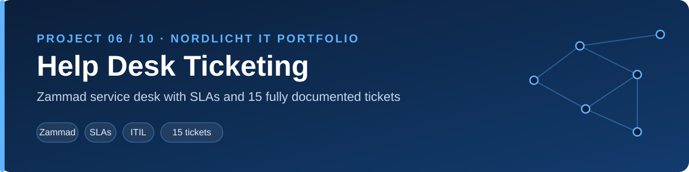
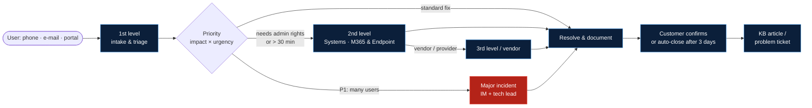

    

> [!NOTE]
> **Kurzfassung (DE):** Aufbau eines Service Desks mit dem Open-Source-Ticketsystem **Zammad** (Docker) für die fiktive *NordLicht Handel GmbH*: Gruppen, Rollen, Prioritäten P1–P4 mit **SLAs**, Makros, Textbausteine und Eskalationsregeln nach ITIL. Dazu **15 vollständig dokumentierte Tickets**, von Kontosperre über Phishing bis BitLocker-Wiederherstellung, jeweils mit Analyse, Lösung, Kundenkommunikation (Deutsch) und Präventionsmaßnahme. Jeder Fehler wurde im Lab nachgestellt.

## Goals
- Run a realistic 1st/2nd-level service desk: intake → triage → troubleshooting → resolution → documentation
- Measure work against **SLAs** and escalate in a structured way
- Write clear tickets that a colleague (or auditor) can follow without asking me

## Setup
| Component | Value |
|---|---|
| Ticket system | Zammad (official Docker Compose stack) on LNX01 / Docker Desktop |
| URL | `http://10.10.10.20:8080` |
| Channels | E-mail (`helpdesk@`), phone (logged manually), web form |
| Groups | `1st-Level Service Desk`, `2nd-Level Systems`, `2nd-Level M365 & Endpoint`, `Requests` |
| Business hours | Mon–Fri 07:00–17:00 (Europe/Berlin), holidays: Thuringia |

Install and configuration steps: [docs/01-setup.md](docs/01-setup.md) · [docs/02-configuration.md](docs/02-configuration.md)

## Ticket flow

## Priorities & SLAs
| Priority | Definition | Example | First response | Resolution |
|---|---|---|---|---|
| **P1 – Critical** | Many users or a business-critical service down, no workaround | E-mail down for everyone, DC unreachable | 15 min | 4 h |
| **P2 – High** | One department or a VIP blocked, or security incident | Warehouse printer down, phishing clicked | 1 h | 8 h |
| **P3 – Normal** | One user affected, workaround possible | Outlook profile broken, account locked | 4 h | 2 business days |
| **P4 – Low** | Request, question, planned change | New hire, software request | 8 h | 5 business days |

Priority = **impact × urgency**; details and the escalation path are in [docs/03-sla-escalation.md](docs/03-sla-escalation.md).

## The 15 tickets
| # | Ticket | Category | Prio | Skills |
|---|---|---|---|---|
| 01 | [INC-1001 Account locked every morning](tickets/INC-1001-account-locked.md) | Identity | P3 | AD lockout source, event 4740 |
| 02 | [INC-1002 Outlook crashes on start](tickets/INC-1002-outlook-profile.md) | M365 / Client | P3 | Safe mode, new profile, OST |
| 03 | [INC-1003 Warehouse printer queue stuck](tickets/INC-1003-printer-spooler.md) | Printing | P2 | Print spooler, queue cleanup |
| 04 | [INC-1004 Internet works, shares and intranet don't](tickets/INC-1004-wrong-dns.md) | Network | P3 | DNS, ipconfig, nslookup |
| 05 | [INC-1005 Drive S: missing for new colleague](tickets/INC-1005-drive-mapping.md) | Access | P3 | AGDLP, GPO, Kerberos token |
| 06 | [REQ-1006 New hire: Leyla Yılmaz (Sales)](tickets/REQ-1006-onboarding.md) | Request | P4 | Onboarding script, M365, Intune |
| 07 | [INC-1007 New phone, Authenticator gone](tickets/INC-1007-mfa-new-phone.md) | Identity | P3 | Identity check, TAP, MFA |
| 08 | [INC-1008 Phishing e-mail, link clicked](tickets/INC-1008-phishing.md) | Security | P2 | Revoke sessions, purge, report |
| 09 | [INC-1009 "Device not compliant", no Outlook](tickets/INC-1009-intune-noncompliant.md) | Endpoint | P3 | Intune compliance, BitLocker |
| 10 | [REQ-1010 Software request: PDF editor](tickets/REQ-1010-software-request.md) | Request | P4 | Approval, Company Portal, licensing |
| 11 | [INC-1011 No sound in Teams meetings](tickets/INC-1011-teams-audio.md) | Collaboration | P3 | Audio devices, Teams cache |
| 12 | [INC-1012 C: drive full](tickets/INC-1012-disk-full.md) | Client | P3 | Storage Sense, OneDrive, cleanup |
| 13 | [INC-1013 BitLocker recovery screen](tickets/INC-1013-bitlocker-recovery.md) | Endpoint | P2 | Recovery key, identity check |
| 14 | [REQ-1014 Leaver: René Lefèvre](tickets/REQ-1014-offboarding.md) | Request | P4 | Offboarding AD + M365 + Intune |
| 15 | [INC-1015 Projector: no signal, meeting in 10 min](tickets/INC-1015-projector.md) | Meeting room | P2 | HDMI, display modes, on-site support |

> ℹ️ All tickets are **lab scenarios** for the fictional NordLicht company: no real customer data. Each fault was reproduced in my lab (see the *Lab reproduction* section of every ticket) and worked through in Zammad.

Each ticket follows the same [template](templates/ticket-template.md): symptoms → triage → troubleshooting → root cause → resolution → communication → prevention → **lab reproduction**.

## Communication templates
[`templates/communication-de-en.md`](templates/communication-de-en.md) has text modules in German and English for first response, asking for information, resolution, closing, and major-incident status updates.

## Lab evidence
- [ ] Zammad dashboard with ticket overview → `screenshots/dashboard.png`
- [ ] SLA configuration → `screenshots/sla.png`
- [ ] One ticket with full history (internal notes + customer reply) → `screenshots/ticket-detail.png`
- [ ] Macro "Resolved – waiting for confirmation" → `screenshots/macro.png`
- [ ] Reporting: tickets per category / SLA breaches → `screenshots/reporting.png`

## Skills shown
ITIL incident/request management · SLAs & escalation · Zammad administration (groups, roles, SLAs, triggers, macros) · Docker · structured troubleshooting · customer communication in German and English · documentation

---

<a href="https://github.com/BigDougCed/05-intune-endpoint-management">05 Intune</a> &nbsp;·&nbsp; <a href="https://github.com/BigDougCed">Portfolio</a> &nbsp;·&nbsp; <a href="https://github.com/BigDougCed/07-it-knowledge-base">07 Knowledge base</a>

